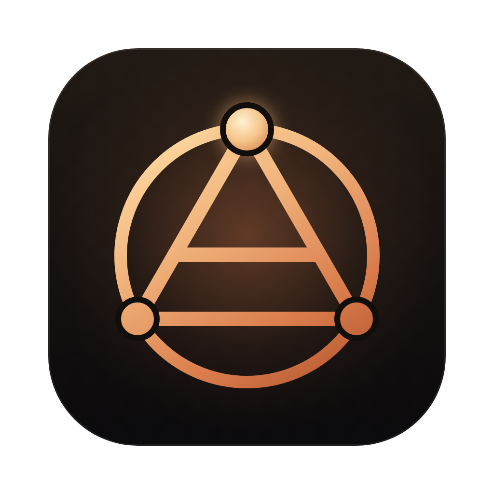

<div align="center">



# Alchemist Coder

**The lab for your coding agents.**

A free, open-source desktop app for Claude Code and Codex. Follow every agent and every subagent it spawns, live. Give work to your own organization of agents, let them drive a browser while you watch, or put them on Autopilot. Search every conversation you've had with Claude Code, Codex, Gemini CLI and Grok Build.

[](https://github.com/Alekla0126/alchemist-coder/releases/latest)
[](LICENSE)

[](https://agentclientprotocol.com/get-started/clients)
[](https://github.com/Alekla0126/alchemist-coder/stargazers)

**[Download](https://coder.alekla.com/#download)** · [Website](https://coder.alekla.com) · [What's new in 1.3.4](https://github.com/Alekla0126/alchemist-coder/releases/tag/v1.3.4) · [Ideas and questions](https://github.com/Alekla0126/alchemist-coder/discussions) · [Español](#español)


<sub>Real screens with a demo project; the agents run on local models. If it's useful to you, a star helps other people find it.</sub>

</div>

> **Version 1.3.4**, in English, Español, Português, Français, Deutsch, Italiano, Русский, 日本語, 한국어, 简体中文 and हिन्दी. [Download](https://coder.alekla.com/#download) for macOS (Apple Silicon or Intel), Windows or Linux (AppImage or .deb), or from [Releases](https://github.com/Alekla0126/alchemist-coder/releases). The builds aren't signed with an Apple or Microsoft certificate yet. The first time on a Mac, macOS says it can't verify the app: click Done, then open System Settings → Privacy & Security and click Open Anyway. On Windows, if SmartScreen warns you, choose More info → Run anyway. Feedback and issues are welcome.

## What it does

- **Autopilot (new in 1.3).** One switch in the title bar and your agents stop waiting for you: permissions are allowed once, questions go back to the agent to decide, and plans and automation steps are approved for you. What can't be undone (`sudo`, force-pushes, publishing to npm, cargo, GitHub releases, the stores or Docker, wiping a disk) is always refused. The Coordinator has its own "Decides everything" switch for the organization, and saves a short lesson after each mistake that every later prompt carries.
- **A browser your agents drive (new in 1.3).** The globe in the title bar opens a browser next to the conversation. Every agent gets tools to open, read, click, type, scroll and screenshot pages, the pane says which agent is driving, and "Take over" makes it wait until you hand it back. New in 1.3.1: tabs, and a browser of its own for each project, with its own cookies and sign-ins, so one project's agents never see another's pages.
- **Google Play, App Store Connect and AdMob, built in.** Agents get tools for the stores through their official APIs instead of driving the consoles in a browser: listings, .aab uploads, tracks and staged rollouts, Android vitals, versions, builds and App Review submission, reviews and replies, sales and AdMob earnings. Everything that changes something is a dry run until you approve it. Set up a service once with [app-console-mcp](https://github.com/Alekla0126/app-console-mcp) (`appconsole config set …`) and every agent and automation gets its tools; services you haven't set up add nothing. Needs [uv](https://docs.astral.sh/uv/).
- **Attach any file (new in 1.3).** Drop, paste or pick PDFs, spreadsheets, archives, audio, video or code; agents open each file with their own tools.
- **One history for all four agents.** Indexes Claude Code (`~/.claude/projects`), Codex (`~/.codex/sessions`), Gemini CLI (`~/.gemini/tmp/*/chats`) and Grok Build (`~/.grok/sessions`) into a local SQLite index with full-text search. Your original files are only read, never modified.
- **Keep every conversation.** Claude Code deletes transcripts after 30 days by default; the opt-in versioned backup mirrors your Claude Code and Codex history into a git repository you choose, and conversations the CLIs delete stay in the app. Export any conversation, subagents included, to Markdown, HTML or JSON.
- **An organization of agents.** A standing coordinator takes your assignments, plans them (review the plan first if you like) and hands the work to the agents you add over time, each with its own little monster (or a picture you choose), role and instructions, model, permissions and projects. Write what you need once, in one box: you stay on the organization chart, where each agent's card shows its task and what it's doing right now, and you approve the plan right there. Drag an agent onto another to put it on its team. A "Needs you" inbox gathers their questions, permission requests and plans, and each agent keeps a record of what it did.
- **In 11 languages.** English, Spanish, Brazilian Portuguese, French, German, Italian, Russian, Japanese, Korean, Simplified Chinese and Hindi: the app, its menus and what automations say. It follows your system's language, or pick one in Settings.
- **Automations.** Describe a routine in plain words and an agent draws it as a flow diagram: steps your agents do, decisions they make and the ones that wait for you. It runs on its own (every day, on some weekdays, every few minutes or nonstop) with a daily spending cap; you choose how much it decides alone, and its questions reach your Mac and your phone through your own Telegram bot. The office template hands cards on the Board to your agents like employees.
<p align="center"></p>

- **Every project's agents in one place.** Switch the sidebar to All projects to follow the conversations and agents of every open project without switching, and read each conversation as one clean document.
- **Marketing mode.** A brand guide every agent reads (marketing/BRAND.md), a studio for posts, threads, emails, App Store and Google Play listings with real character limits and previews, an editorial calendar, and a marketing team in your organization. Agents may only claim what the brand guide lists.
- **A board for the work.** The Board lays out every task and conversation by phase (backlog, planning, implementing, validating, done). Conversations move on their own as their agents work; write tasks down and hand one to an agent with a click; open, close and reopen cards from icons on each card.
- **Everything about a message in chips.** Agent or Plan mode, permissions, agent CLI, model, reasoning effort, ready-made actions (plus your project's own in `ai-actions.md`) and how full the context is, all one click away under the message box.
- **Fits half a screen.** Fold the sidebar with one button (⌘B) or by dragging it away; below 900 px the sidebar floats over the page and the modes fit in one menu, so the app works side by side with another window.
- **Agent tree.** Every conversation shows the main agent, the subagents it launched and the ones those launched in turn, with live status, tokens, time, estimated cost, worktree and branch. Add an agent right there (its main agent launches it, with the type and task you choose), or take one out of the list or stop it.
- **A chat by agent.** Tabs over the conversation switch between the main agent and each subagent; every turn says who speaks, and each subagent shows up where it was launched as a card with how it's doing, its cost, what it was asked and what it answered.
- **How long ago, at a glance.** Recent, in the Agents sidebar, lists the latest conversations of every project, newest first under Today, Yesterday and the past week. Each one says its project and how long ago it was, with a mark that fades from green (the last 15 minutes) to grey, and keeps up by itself.
- **Who's working, at a glance.** The status bar says who needs you and who is working right now (in the app or in a terminal), what each one is doing and for how long; one click takes you there. The Dock or taskbar icon counts what needs you while you're in another app.
- **How much of your plans you've used.** A gauge per plan over the settings gear (Claude, ChatGPT through Codex, Kimi Code): the 5-hour window and the week, when each resets, and each CLI's version with a button when a newer one is out. It follows the CLIs' own files as they work instead of polling.
- **Git in plain words.** A Git tab shows your branch, what's waiting to push or pull, what isn't committed yet, the history (agents' commits marked), branches and the agents' own copies; check the remote, pull and push from there.
- **A welcome on a new computer.** The first launch shows the conversations already found, each agent CLI (ready, not signed in or missing, with the button that fixes it), the models agents can run on, and a project to start with. Help → Welcome opens it again.
- **Several projects at once**, with modes for agents, code, split view, terminal and history. The code editor has an optional Vim mode.
- **Four coding agents, one workspace.** Claude Code, Codex, Gemini CLI and Grok Build run through the [Agent Client Protocol](https://agentclientprotocol.com): you see their plan, every tool call, file diffs and cost live, approve or deny each permission inline, and switch mode (ask, accept edits, plan, allow everything) or model mid-session.
- **Arena: plan first, then let agents compete.** A planner agent drafts a plan in read-only mode; you edit and approve it; one to four agents (mix CLIs and models) solve the task in parallel, each in its own git worktree under `.alchemist/worktrees`. Compare their changes, diffs, tests, time and cost, then merge the winner (squash or merge commit) — your checkout is untouched until then.
- **Preview what agents build.** HTML and mockups run in a sandboxed, offline iframe; Markdown renders with Mermaid diagrams; images and SVG open as images — next to the code, or per agent in the Arena.
- **One extensions hub for four CLIs.** See every MCP server, skill and hook across Claude Code, Codex, Gemini CLI and Grok Build (including what Grok imports from Claude), copy a server to the agents that lack it with their own `mcp add`, and share one `AGENTS.md` with every agent.
- **Run agents with local models** (Ollama, LM Studio) — Claude Code and Codex work fully offline in the Community edition.

## Editions

| | Community (this repo) | Pro |
|---|---|---|
| License | AGPL-3.0 | Proprietary |
| History, search, agent tree, projects, modes | ✅ | ✅ |
| Agents with local models | ✅ | ✅ |
| Claude, ChatGPT, Gemini, Grok and Kimi K3 with your own account | — | ✅ |
| Sign in and end-to-end encrypted sync | — | ✅ |

Alchemist Coder never charges for tokens: you bring your own models, subscriptions and API keys.

**No telemetry, no account.** The app sends nothing about you or your code anywhere. On its own it only asks npm and PyPI which agent CLI versions are current; it talks to Telegram only if you turn on your own bot, to Kimi only if you give it a Kimi token, and to Google and Apple (with uv fetching app-console-mcp from GitHub the first time) only for the store services you set up. Everything else stays on your computer.

## Requirements

- Node.js 22.13+ (the indexer uses the built-in `node:sqlite`) and pnpm 8+
- To run agents: `npx` (Node.js) for the Claude Code and Codex ACP adapters (pinned versions, fetched on first use), [Gemini CLI](https://github.com/google-gemini/gemini-cli) for Gemini, and optionally [Grok Build](https://x.ai/cli) (otherwise fetched through `npx`)
- Optional: [Ollama](https://ollama.com) or LM Studio for local models

## Getting started

```bash
pnpm install
pnpm dev          # run the desktop app
pnpm test         # unit tests
pnpm typecheck
pnpm index:smoke  # index your real history into a throwaway database and print stats
```

## Repository layout

```
apps/desktop            Electron app (main, preload, React renderer)
packages/core           Shared types, extension API, pricing, edition rules
packages/indexer        Claude Code + Codex parsers, agent tree, SQLite/FTS5 index, file watcher
packages/harness        ACP client for Claude Code, Codex, Gemini CLI and Grok Build (plus headless claude/codex fallbacks)
packages/providers-local Local model providers (Ollama, LM Studio)
packages/arena          Plan-first prompts and git worktrees for the Arena (create, diff, test, merge, clean up)
packages/themes         VS Code themes from .vsix packages and Open VSX (zip, JSONC, includes, checksums)
packages/archive        Conversation export (Markdown, HTML, JSON) and the versioned history backup
packages/extensions     Reads and edits the MCP servers, skills, hooks and instructions of the four agent CLIs
```

Extensions register harnesses, providers and feature gates through `defineExtension()` in `@alchemist-coder/core`.

## Contributing

Read [CONTRIBUTING.md](CONTRIBUTING.md). Contributions require signing the [CLA](CLA.md) once.

## License

[GNU AGPL-3.0](LICENSE). Claude and Claude Code are trademarks of Anthropic, PBC. ChatGPT and Codex are trademarks of OpenAI. Kimi is a trademark of Moonshot AI. Alchemist Coder is an independent project and is not affiliated with any of them.

---

## Español

**El laboratorio de tus agentes de código.** Abre varios proyectos a la vez, sigue cada agente y cada subagente que lanza (y añade o quita agentes ahí mismo, en el árbol de la conversación), edita con tus temas de VS Code y retoma cualquier conversación de Claude Code o Codex. Conserva tu historial con un respaldo versionado (Claude Code borra las conversaciones de más de 30 días) y exporta cualquier conversación a Markdown, HTML o JSON. Claude Code, Codex, Gemini CLI y Grok Build corren por el Agent Client Protocol: ves su plan, cada herramienta, los diffs y el costo en vivo, y apruebas o niegas cada permiso ahí mismo. En la **Arena**, un agente planifica, tú apruebas el plan y hasta cuatro agentes compiten en worktrees de git; comparas sus cambios y tests y fusionas el mejor. La vista previa muestra el HTML, Markdown con diagramas e imágenes que crean los agentes, y el centro de extensiones ordena los MCP, skills, hooks y AGENTS.md de los cuatro CLIs. Con **Todos los proyectos** sigues a los agentes de cada proyecto abierto sin cambiar de proyecto; el **Tablero** ordena tareas y conversaciones por fase (pendiente, planificando, implementando, validando, hecho) con botones claros para abrir, cerrar y reabrir; los chips bajo el mensaje eligen modo, permisos, agente, modelo, esfuerzo y acciones y muestran el contexto; la barra lateral se pliega con un botón y la app cabe en media pantalla; y la pestaña **Git** te dice en palabras simples en qué rama estás, qué falta por subir o bajar, qué no tiene commit y quién hizo cada commit. El modo **Marketing** trae guía de marca, estudio de contenido con límites reales por red, calendario editorial y un equipo de marketing. En la vista **Organización**, un coordinador permanente recibe tus encargos, los planifica y reparte el trabajo entre los agentes que vas sumando, cada uno con su rol, instrucciones, modelo, permisos y proyectos; escribes lo que necesitas una sola vez y en el organigrama ves la tarea de cada agente, lo que hace ahora y apruebas el plan ahí mismo; arrastra un agente sobre otro para ponerlo en su equipo. El chat se organiza por agente, con pestañas para el agente principal y cada subagente, y la barra de estado te dice quién te necesita y quién está trabajando. Nuevo en 1.3: el **Piloto automático** (un interruptor en la barra de título y tus agentes dejan de esperarte: los permisos se conceden una vez, sus preguntas las deciden ellos y los planes se aprueban solos; lo que no se puede deshacer, como `sudo`, forzar un push o publicar, siempre se rechaza), un coordinador que «Decide todo» y guarda una lección después de cada error, un **navegador dentro de la app** que manejan tus agentes mientras tú miras (con «Tomar el control»; desde 1.3.1, con pestañas y un navegador propio para cada proyecto) y adjuntar cualquier tipo de archivo a un mensaje. Además, **Google Play, App Store Connect y AdMob vienen integrados**: configura un servicio una vez con [app-console-mcp](https://github.com/Alekla0126/app-console-mcp) y cada agente y automatización recibe sus herramientas (fichas, subir .aab, lanzamientos graduales, vitals, enviar a App Review, reseñas, ventas y ganancias de AdMob) por las API oficiales, sin navegador y con ensayo antes de cada cambio. La edición Community es open source (AGPL-3.0) y funciona con modelos locales. Sin telemetría y sin cuenta: la app no envía nada sobre ti ni tu código; por su cuenta solo consulta a npm y PyPI qué versiones de los CLIs de agentes hay. [Descárgala](https://coder.alekla.com/es/#download) para macOS, Windows o Linux (todavía sin firma de Apple ni Microsoft: la primera vez, en Mac haz clic en Listo y luego en Ajustes del Sistema → Privacidad y seguridad → Abrir de todas formas; en Windows, Más información → Ejecutar de todas formas). Ideas y preguntas en [Discussions](https://github.com/Alekla0126/alchemist-coder/discussions); para contribuir, lee [CONTRIBUTING.md](CONTRIBUTING.md).
